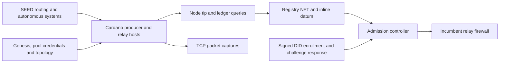

# Cardano experiments in SEED Emulator

This work was carried out as a Field Project at Università della Svizzera italiana (USI), with CyberTel as the industry collaborator.

This Università della Svizzera italiana (USI) Field Project investigates how private Cardano networks behave on a routed emulated Internet. The experiments progress from basic block production to ledger-backed relay authorization. They ask when a message or measurement can be checked against a ledger, what separates connectivity from chain compatibility, and how a ledger decision can inform network admission.

All nine packages passed fresh genesis generation, SEED topology compilation and Compose configuration checks. [B11 also passed a controlled runtime smoke test](docs/audit/b11-runtime-result.md).

The [historical results](docs/results/historical-results.md) identify the observations supported by the original evidence, including B12 confirmations, B14 packet traces and B16 identity and revocation records. The B13 entries distinguish configuration evidence from protocol or ledger outcomes. The newly developed B15/B16 deployment helpers were validated offline. Fresh integrated execution of those helpers remains unverified. See the [validation matrix](docs/audit/validation-matrix.md).

## System architecture

SEED Emulator compiles routed autonomous systems and their hosts to Docker Compose. Depending on the experiment, the hosts run Cardano producers, relays or a separate identity test host. Independent chain profiles select their own genesis and node topology. B15/B16 introduce an application layer that reads an Aiken-governed registry UTXO and changes Linux firewall state. B16 also evaluates signed enrollment and a challenge–response check.

## Experiments

| Experiment | Focus | Node release |
|---|---|---|
| [B11](experiments/B11-cardano/README.md) | Private Cardano deployment, producer credentials and relay synchronization | 11.0.1 |
| [B12](experiments/B12-cardano/README.md) | Conway transactions, CIP-20, sensor integrity and benchmarks | 11.1.3 |
| [B13 interoperability v2](experiments/B13-cardano-interoperability-v2/README.md) | Two independent chains and distinct network magic | 11.1.3 |
| [B13 node join](experiments/B13-cardano-node-join/README.md) | Staged same-ledger relay synchronization | 11.1.3 |
| [B13 same magic](experiments/B13-cardano-same-magic/README.md) | Equal magic, distinct genesis and staggered starts | 11.1.3 |
| [B13 same time](experiments/B13-cardano-same-time/README.md) | Equal magic and initial time, distinct genesis | 11.1.3 |
| [B14](experiments/B14-cardano-relay-admission/README.md) | Linux firewall admission and revocation | 11.1.3 |
| [B15 v2](experiments/B15-cardano-smart-authorization-v2/README.md) | Aiken registry NFT, authorization and firewall enforcement | 11.1.3 |
| [B16](experiments/B16-cardano-did-authentication/README.md) | Ed25519 DID enrollment, authentication and ledger-backed admission | 11.1.3 |

See the [experiment selection report](docs/audit/experiment-selection.md) for the disposition of the two earlier candidates.

## Setup and operation

1. Use an isolated Linux x86-64 emulator host. The observed toolchain includes Python 3.8.10, Docker 20.10.21 and standalone Compose 1.27.4.
2. Install the pinned SEED Emulator checkout and its Python dependencies. Configure a working Docker installation. Install Python cryptography for B16 and Aiken v1.1.24 with the project-pinned stdlib v4.0.0 for contract work. [Installation and verified Cardano checksums](docs/reproducibility/install.md)
3. Select an experiment above, place its Cardano release under the compiler's `resources/cardano-static/` directory and generate its own genesis and credentials. [Genesis and deployment guide](docs/reproducibility/genesis.md)
4. Follow that experiment's build, startup and verification commands. Use distinct runtime state for a fresh run. Check node tips, common block points and the applicable ledger output. [Docker and packet capture procedures](docs/reproducibility/operations.md)
5. Consult the [runtime verification plans](docs/reproducibility/runtime-verification.md) and, for B15/B16, the [registry and admission procedure](docs/reproducibility/registry-procedure.md). Use the [troubleshooting guide](docs/troubleshooting/README.md) for missing configuration, binaries, sockets, container names and credentials.

Run the release's offline source checks with `python3 scripts/validate-static.py`.

## Results and limitations

The historical B12 ten-pair benchmark recorded 20 transfers confirmed at the four queried nodes. In that run the metadata group used larger transactions and higher fees, and observed confirmation medians differed. B14 candidate captures show SYN-ACK packets in the admitted window and none in the initial or restored denial windows. B16 historical application records show rejection of specific impersonation, replay and DID-substitution probes. The test scope, evidence paths and interpretation limits are recorded in the [historical evidence summary](docs/results/historical-results.md).

Network magic and time are compatibility variables. Demonstrating interoperability requires evidence about both protocol and ledger state. A registry NFT establishes continuity within its configured policy. The off-chain controller decides when to apply firewall changes. DID enrollment and challenge signatures demonstrate possession of the enrolled private key in the tested context. Physical identity still depends on enrollment, key custody and the endpoint binding.

Future work includes fresh paired B13 runs, synchronized per-flow firewall and ledger traces, scripted registry deployment, and evaluation of key rotation and replay state across gateway replicas.

## Repository layout and release review

- `experiments/` contains launchers, selected experiment code and experiment READMEs.
- `docs/audit/` contains the inventory, [source audit](docs/audit/source-audit.md), [configuration audit](docs/audit/configuration-audit.md), [dependency map](docs/audit/dependency-map.md), [security review](docs/audit/security-review.md) and [file disposition](docs/audit/file-disposition.md).
- `docs/reproducibility/` contains installation, genesis, operation and [publication instructions](docs/reproducibility/publication-checklist.md).
- `docs/results/` contains the historical evidence summary.
- `scripts/` contains fresh genesis preparation and offline validation.

See the [publication checklist](docs/reproducibility/publication-checklist.md) for the release review and approval gates.

## Attribution and references

This project was developed for a university Field Project at Università della Svizzera italiana. The release uses SEED Emulator and Cardano as independent dependencies. See [attribution and licensing](NOTICE.md) for the upstream notices and remaining release decision.

- [SEED Emulator](https://github.com/seed-labs/seed-emulator)
- [Cardano Core Node](https://github.com/IntersectMBO/cardano-node)
- [CIP-20 transaction message metadata](https://cips.cardano.org/cip/CIP-0020)
- [Aiken v1.1.24](https://github.com/aiken-lang/aiken/releases/tag/v1.1.24)
- [W3C Decentralized Identifiers v1.0](https://www.w3.org/TR/did-core/)
