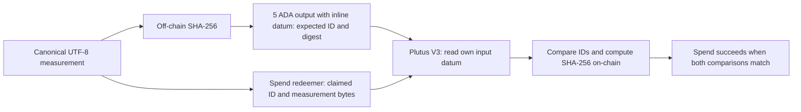

# B12-P9 final sensor-hash smart-contract report

On 2026-11-20, all four B12-P9 nodes verified a successful Plutus V3 spend that matched the funded SHA-256 commitment for a synthetic AGRI-002 measurement. The experiment used the existing private network, magic **4343**, Conway ledger protocol **9.0**, with AS150–AS152 as producers and AS153 as relay. The successful spend and its negative controls answer different questions. The spend shows ledger acceptance of the matching measurement. The controls show rejection during local script evaluation. [Cutover and execution record](B12_P9_sensor_hash_cutover.md)

## Architecture and data



The synthetic measurement was the exact UTF-8 byte sequence below. Its fields are the sensor ID, UTC timestamp, temperature in Celsius with one decimal digit, and relative humidity as an integer percent. The encoding uses ASCII vertical-bar separators, no whitespace or trailing newline, and no byte-order mark.

```text
AGRI-002|2026-11-20T10:00:00Z|23.6|61
```

Its SHA-256 is `b76cef7674424ef76659031a5cf22f1d9b38316c2fe1e71cdbd12c75fc30ac26`. Funding transaction `cec962433d2049aa7ab1fd16493dc498a1116ef480d4aab7fa424441ac0f7510` created the 5 ADA script output at index `#0` in block 1593, slot 53852. Its inline datum fixed the expected sensor ID and digest. The spend supplied the claimed ID and measurement bytes in the redeemer. The validator finds its own consumed input, requires its inline datum, decodes both records, and checks the ID and `sha2_256(claimed.measurement)`. The spend cannot supply a replacement commitment for that input. [Validator source](../../experiments/B12-cardano/smart-contract/sensor-validation/validators/sensor_hash_validation.ak) · [Sanitized evidence](../results/b12/sensor-hash-verification.json)

## Test results

All seven sensor-hash unit tests and three original tests passed under Aiken 1.1.24 and stdlib 4.0.0. A positive CLI evaluation also succeeded using live protocol parameters. For the local CLI controls, the evaluator used the actual funded UTXO and captured protocol parameters and era history. The matching offline control reproduced the live budget. Each negative CLI control failed in the expected script witness. [Offline verification report](B12_sensor_hash_offline_verification.md) · [Live-parameter evaluation record](B12_P9_sensor_hash_cutover.md#separately-approved-unsigned-spend-and-local-evaluation)

| Case | Fixture change | Result |
| --- | --- | --- |
| Matching ID and measurement | Claimed `AGRI-002` and exact bytes shown above | Passed evaluation and on-chain execution |
| Altered temperature | `AGRI-002\|2026-11-20T10:00:00Z\|23.7\|61` | Rejected locally because the hash differed |
| Altered humidity | `AGRI-002\|2026-11-20T10:00:00Z\|23.6\|62` | Rejected locally because the hash differed |
| Incorrect sensor ID | Claimed `AGRI-001`, original measurement bytes | Rejected locally because the ID differed |
| Malformed redeemer | Integer `0` supplied in place of the record | Rejected locally during decoding |
| Alternate numeric formatting | `23.60` in place of `23.6` | Rejected in the unit tests and an offline CLI check |
| Missing datum | No datum on the input | Rejected in the unit tests |

No invalid transaction was submitted.

## Confirmed spend and cost

| Field | Verified value |
| --- | --- |
| Spend transaction ID | `b944855580f84b08a03bda144bac657fc263658d07fa4ff090c0ea4d7f374181` |
| Block and slot | Block **1661**, slot **55199**, transaction index 0 |
| Block hash | `5463a2ca3de45ad228faa92ebab92f23472e472f6b65f776e1c73b53eaea4115` |
| Script input | 5,000,000 lovelace, consumed |
| Recipient | 4,995,583 lovelace to Delegator 3, no separate change output |
| Total fee | 4,417 lovelace |
| Plutus V3 execution budget | 41,108 memory units and 15,289,580 CPU steps |
| Evaluated script execution cost | 3,475 lovelace, included in the total fee |

The transaction balances as `5,000,000 = 4,995,583 + 4,417` lovelace. Execution units measure the computation budget. The script cost prices that budget using the live ledger parameters. The remaining 942 lovelace is the difference between the total fee and the evaluated execution cost.

AS150, AS151, AS152 and AS153 each returned the same canonical block hash and identical containing-block bytes. Verification matched the exact signed transaction body to that block, confirmed a valid transaction index, and checked the expected payout, disappearance of the funded input, and unchanged collateral. The decoded on-chain witness contained the expected Plutus V3 script hash, `AGRI-002` redeemer, exact measurement bytes and the recorded execution units. [Sanitized inclusion and witness evidence](../results/b12/sensor-hash-verification.json) · [Export checksums](../results/b12/SHA256SUMS)

## Validator comparison and security limits

| Validator | Enforced rule | Script hash |
| --- | --- | --- |
| Original sensor-ID validator | Supplied sensor-ID bytes match the ID stored in the datum | `16f6b8ccfeb9173cb8c5fcfe4cfba48c685ed231636e92d316bf2c83` |
| Sensor-hash validator | The spent output has an inline datum, the ID matches, and on-chain SHA-256 of the measurement bytes matches the funded digest | `f7b1435250172148a3c6c2fc5eccf212062d314cd11744018af5fa29` |

The original source and script hash were preserved. Successful hash verification proves integrity relative to the chosen commitment. It **does not prove sensor authenticity or measurement truthfulness**. A funder can commit to fabricated data. The script treats the measurement as opaque bytes and leaves freshness, units, format and provenance to the application. It imposes no sensor-specific signature requirement. A party with the matching bytes can satisfy the script if the rest of the transaction is valid. The redeemer reveals those bytes on-chain. CIP-20 auxiliary metadata has a separate role and is outside this check. [Original validator](../../experiments/B12-cardano/smart-contract/sensor-validation/validators/sensor_validator.ak) · [Measurement validator](../../experiments/B12-cardano/smart-contract/sensor-validation/validators/sensor_hash_validation.ak)

## Reproducibility on the existing B12-P9 network

1. For an evidence-only replay, verify the saved inclusion manifest and inspect the four-node and witness proofs above. The full raw replay requires the operator's saved block and signed body. Keep the signed envelope, keys and databases private.
2. For a local reproduction, generate the fixtures into a new directory with `generate_sensor_hash_fixtures.py`, rerun it with `--verify`, and run `aiken check` and `aiken build` in the Aiken project. Export only the measurement validator with `aiken blueprint convert -m sensor_hash_validation -v sensor_hash_validation`. Compare its script hash and measurement hash with this report. Use the offline evaluator and a consistent protocol-9 context to repeat the local controls.
3. For a separately authorized live rerun, use the existing B12-P9 deployment, verify magic 4343, Conway 9.0, the Plutus V3 model and four-node agreement, then begin at fixture generation and compilation in the demo runbook. The original script output has been consumed. A rerun requires a new 5 ADA funding output, fresh input selection and distinct approvals for funding and spending. Run the negative controls locally and repeat the exact-body verification for the new spend. [Commands and expected results](B12_sensor_hash_smart_contract_demo.md) · [Existing deployment paths and continuity checks](B12_P9_sensor_hash_cutover.md)

## Demo walkthrough

1. **Show the commitment.** Display the canonical measurement and its digest. Point to the funding output's inline datum and explain what it fixed before spending.
2. **Show acceptance and rejection.** Display the matching redeemer and the confirmed spend. Show the saved altered-temperature trace and explain how a one-field change caused the hash comparison to fail locally.
3. **Show verification and limits.** Open the four-node proof and confirm the shared block hash, payout and retained collateral. Close by stating that the test establishes byte integrity against a commitment. Authenticating the sensor or proving the reading true would require additional controls.

The walkthrough can use archived evidence throughout.
